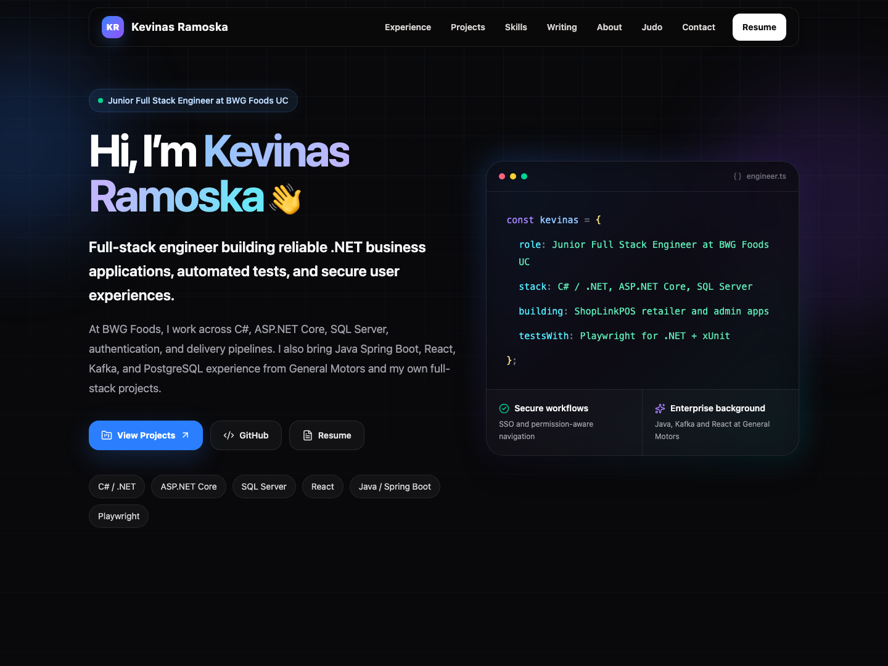

# Kevinas Ramoska - Software Engineering Portfolio

[Live portfolio](https://kevinasramoska-portfolio.vercel.app)



Next.js 16 · React 19 · TypeScript · Tailwind CSS 4 · Playwright + axe · Vercel

Portfolio for a Junior Full Stack Engineer at BWG Foods UC, with General Motors
experience, full-time international judo from 2024 to 2026, engineering case
studies, and technical writing.

## Stack and quality

Next.js 16 App Router, React 19, TypeScript, Tailwind CSS 4, and Vercel. Most
content renders as static server components; the responsive header is interactive.
Playwright and axe verify browser journeys and automated accessibility. CI checks
the resume, dependencies, lint, types, production build, and browser tests.

Use Node.js 24 LTS:

```bash
nvm use
npm ci
npm run dev
```

```bash
npm run check
npm run audit
npx playwright install chromium
CI=1 npm run test:e2e
```

The CI browser suite tests the production build. Local tests use the development
server unless `CI=1` is set.

## Content ownership

| Source | Controls |
| --- | --- |
| `src/content/career.json` | Identity, contact links, roles/dates/bullets, About, degree, credential, resume skills |
| `src/content/profile.ts` | Derived current role, canonical origin, public profile adapter |
| `src/content/projects.ts` | Project cards, case studies, screenshots, metrics, resume project bullets |
| `src/content/articles.ts` | Four technical articles |
| `src/content/current.ts` | Current working/learning interests |
| `src/content/judo.ts` | Judo career and profile links |
| `resume/template.html` | Print layout only |

Career details are shared by the website and resume generator. Update the canonical
content, not a second work-history list inside a React component or generated HTML.
The Microsoft credential link comes from the supplied resume JSON.

## Regenerating the resume

After editing career/project content or the print template:

```bash
npm run resume:build
npm run resume:check
```

The generator uses Chrome/Chromium; set `CHROME_PATH` if it is outside the standard
locations. It writes the HTML preview, tagged A4 PDF, and a content/PDF hash manifest.
Review the rendered PDF and commit all three generated artifacts.
CI fails when the HTML, PDF hash, or source content no longer matches the manifest.
It does not require Chrome merely to check an existing PDF.

The served asset is `public/kevinas-ramoska-resume.pdf`; links keep that stable URL.

Domain registration and public demos are deferred; see [the backlog](docs/TASKS.md)
and [release guide](docs/DEPLOYMENT.md) for prerequisites and canonical-origin setup.

## Project evidence

The RentRight case study reflects the React/.NET application at commit `d8216bb`.
Its [24 October CI run](https://github.com/kevinasramoska/RentRight/actions/runs/40082766420)
passed 596 fast .NET tests, 248 SQL integration tests (one additional test skipped),
and 91 frontend tests. These are separate test layers, not one end-to-end total.
The resident screenshots show the real React presentation with synthetic,
in-memory data; they do not prove a live backend operation.

Career and project updates made on 24 October are explained file by file in
[the implementation notes](docs/CHANGES-2026-10-24.md).

## Search discovery

The `/projects` and `/writing` indexes connect the case studies and articles.
Pages have unique metadata, canonicals, structured data, and maintained sitemap
dates; articles also have author bylines and their own sharing images.
See [docs/SEO.md](docs/SEO.md) for Search Console verification and sitemap submission.

## Dependency maintenance

Dependabot checks npm dependencies and pinned GitHub Actions weekly. CI rejects
high/critical production dependency advisories. TypeScript remains on 6.0 and
ESLint on 9 while Next.js's lint plugins require these versions; Node types match
the Node 24 runtime. The full audit still reports the upstream development-only
`braces` chain. Do not force a downgrade of Next tooling to silence it.

The CSP preserves static generation and permits inline framework scripts/styles.
It restricts external resources but is not a strict nonce-based XSS policy.

[Current backlog](docs/TASKS.md) records delivered work and remaining dependencies.
The original August audit, roadmap, and task list are preserved under
[docs/archive](docs/archive/). [Performance measurements](docs/PERFORMANCE.md)
are historical baselines.

## Release flow

Push reviewed changes to `main`; GitHub runs CI and Vercel creates a production
deployment. Verify the deployed commit, resume, primary links, metadata, headers,
and one complete browser journey. Keep the previous deployment available for
rollback; database migrations need a separate compatibility and recovery plan.

## Author

[Kevinas Ramoska on GitHub](https://github.com/kevinasramoska) ·
[LinkedIn](https://www.linkedin.com/in/kramoska/)
